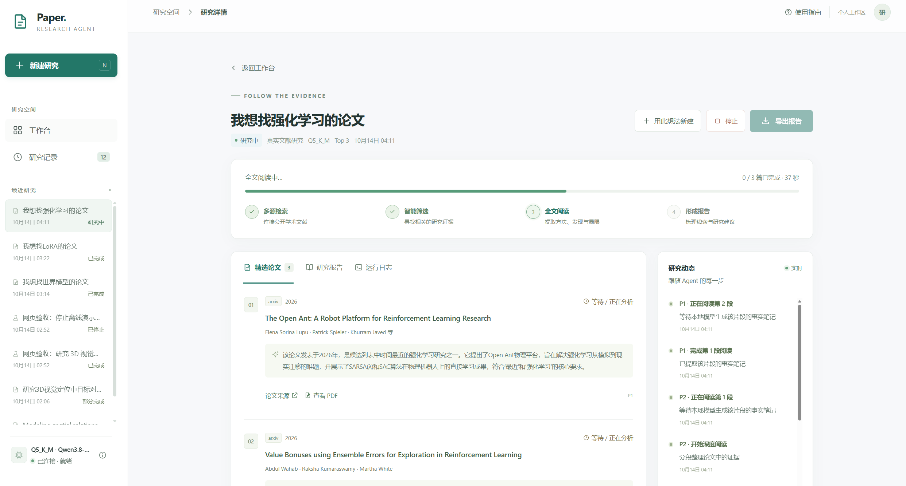

# Paper Research Agent

一个本地论文研究 Agent：根据研究想法检索 arXiv 和 OpenAlex，筛选 Top-K 论文，读取可访问的 PDF，并生成逐篇总结和研究报告。

## 快速部署

### 1. 准备环境

建议使用 Linux、Python 3.11、32 GB 内存、30 GB 以上可用磁盘和 24 GB 显存的 NVIDIA GPU。需预装 Git、curl、CMake、C/C++ 编译器、NVIDIA 驱动及与驱动兼容的 CUDA Toolkit，并确保 `nvcc` 在 PATH 中。

```bash
git clone <YOUR_REPOSITORY_URL> Paper-Research-Agent
cd Paper-Research-Agent

conda create -n paper-agent python=3.11 -y
conda activate paper-agent
python -m pip install -r requirements.txt
```

### 2. 安装 llama.cpp

以下命令使用已验证的 `b11586` 版本，构建支持 NVIDIA CUDA 的 `llama-server`：

```bash
git clone --branch b11586 --depth 1 https://github.com/ggml-org/llama.cpp.git
cmake -S llama.cpp -B llama.cpp/build   -DGGML_CUDA=ON   -DCMAKE_BUILD_TYPE=Release   -DCMAKE_CUDA_COMPILER=/usr/local/cuda-12.2/bin/nvcc   -DCMAKE_CUDA_ARCHITECTURES=89   -DTHREADS_PREFER_PTHREAD_FLAG=ON
cmake --build llama.cpp/build --config Release --target llama-server -j 4
```

生成的程序通常位于 `llama.cpp/build/bin/llama-server`。CPU 或其他加速后端请按 llama.cpp 官方文档选择相应构建选项。

### 3. 准备模型

将 Qwen3.8-27B 的 `Q4_K_M` GGUF 放入项目的 `models/` 目录。

```bash
mkdir -p models
curl -k --location --fail --retry 5 --continue-at - \
  --output models/Qwen3.8-27B-Q4_K_M.gguf \
  https://huggingface.co/bartowski/Qwen3.8-27B-GGUF/resolve/main/Qwen3.8-27B-Q4_K_M.gguf
```

需要在网页切换到 Q5 时，再下载 `Q5_K_M`（约 20.9 GB）。保留 Q4 文件：

```bash
curl --location --fail --retry 20 --retry-all-errors \
  --retry-delay 5 --connect-timeout 20 --continue-at - \
  --output models/Qwen3.8-27B-Q5_K_M.gguf.part \
  https://huggingface.co/bartowski/Qwen3.8-27B-GGUF/resolve/main/Qwen3.8-27B-Q5_K_M.gguf \
&& mv models/Qwen3.8-27B-Q5_K_M.gguf.part models/Qwen3.8-27B-Q5_K_M.gguf
```

### 4. 配置项目

```bash
cp .env.example .env
```

编辑 `.env`，至少填写下面两项的绝对路径：

```dotenv
GGUF_MODEL_PATH=/absolute/path/to/Paper-Research-Agent/models/Qwen3.8-27B-Q4_K_M.gguf
LLAMA_SERVER_BIN=/absolute/path/to/llama.cpp/build/bin/llama-server
```

默认配置使用单个并行槽和每请求 8192 token 上下文。

### 5. 启动模型服务

在第一个终端中运行：

```bash
conda activate paper-agent
cd Paper-Research-Agent
python deploy/serve_gguf.py --managed
```

保持该进程运行。推理监听 `127.0.0.1:8000`，模型切换接口监听 `127.0.0.1:8001`。已有旧模型服务时，先等待研究任务结束，在旧服务终端按 Ctrl+C，再执行上述命令。省略 `--managed` 仍可使用原来的固定模型模式。

### 6. 打开网页界面

网页运行示例：



首次部署先在项目目录创建管理员（交互式设置用户名和密码，无默认账号）：

```bash
python manage_users.py create-admin
```

在同一台服务器的第二个终端中运行：

```bash
conda activate paper-agent
cd Paper-Research-Agent
python web_app.py --port 7860
```

浏览器打开 `http://127.0.0.1:7860`，注册普通用户或登录管理员账号后即可开始。个人空间支持修改用户名、头像、签名和密码；管理员还可管理用户身份、启用/禁用账号、重置用户密码，以及切换全局模型。

如果运行在远程服务器，可用编辑器的端口转发功能，或在自己的电脑上运行：

```bash
ssh -N -L 7860:127.0.0.1:7860 用户名@运行网页的服务器
```

### 命令行运行（可选）

在同一台服务器的第二个终端中运行：

```bash
conda activate paper-agent
cd Paper-Research-Agent

python check_local_model.py
python main_agent.py \
  --idea "我想研究LoRA" \
  --top-k 3 \
  --concurrent
```

命令行结果保存在 `outputs/<run_id>/`：

- `report.md`：最终研究报告
- `topk.json`：Top-K 论文和处理状态
- `metrics.json`：耗时与成功状态
- `fulltext/`、`summaries/`：论文文本和逐篇总结

确认完整成功时，检查 `metrics.json` 中 `task_success=true`，且 `completed_count` 等于请求的 `--top-k`。候选不足时实际数量可能少于 K；PDF 不可访问或来源限流也可能导致部分失败。

## 网络与常见问题

- 论文检索和 PDF 下载需要服务器能够访问 arXiv 与 OpenAlex。
- 使用系统代理时，在 `.env` 中设置 `PAPER_TRUST_ENV=1`，并在启动前配置 `HTTP_PROXY`、`HTTPS_PROXY`；也可以直接设置 `PAPER_PROXY_URL=http://代理地址:端口`。
- `Connection refused` 通常表示模型服务未启动，或 `LLM_BASE_URL` 与监听端口不一致。

## 测试

```bash
python -m unittest discover -s tests -v
```

## 推理速度基准

固定 100 条查询（20 个研究想法 × `top_k` 1~5，中文 75 条、英文 25 条，见 `benchmarks/queries.jsonl`），在本地模型上测平均查询时间。查询集固定，不同模型/量化的结果才能对比。

```bash
python -m benchmarks.prepare_corpus unpack              # 解压仓库自带的冻结语料（benchmarks/corpus.tar.gz，约 3.4 MB），无需联网、无需模型
python -m benchmarks.run_benchmark --label q4            # 默认 stage 模式：完全离线，只测 select + 摘要 + 报告的推理耗时
python -m benchmarks.run_benchmark --label q5 --repeats 3
python -m benchmarks.compare outputs/bench-q4-*/summary.json outputs/bench-q5-*/summary.json
```

- **stage 模式**（默认）：候选论文、参考 Top-k 和全文全部来自 `benchmarks/corpus/`（由 `corpus.tar.gz` 解压得到，目录本身不入库），每个模型处理完全相同的论文，不访问网络。`select` 仍由当前模型真实执行，其结果与参考选择的重合率会记录下来；参考 Top-k 是该想法冻结的 Top-5 的前 k 篇，所以 k<5 时重合率低于 1 是正常的，只用于模型之间相对比较。
- **重新冻结语料**（仅维护者，会改变测试集内容，旧结果不再可比）：先启动模型服务，运行 `python -m benchmarks.freeze_corpus`（需联网，约 1 小时；arXiv 限流时会自动重试），再运行 `python -m benchmarks.prepare_corpus pack` 并提交新的 `corpus.tar.gz`。修改 `queries.jsonl` 后也必须这样做，否则测试 `test_committed_archive_covers_all_100_queries` 会失败。
- **e2e 模式**（`--mode e2e --limit 10`）：真实启动 `main_agent.py`，包含联网检索与 PDF 下载，只用于估算端到端耗时，不能与 stage 结果对比。
- 查询顺序由 `--seed` 决定，默认一条接一条串行；`--warmup`（默认 3）额外跑几条预热查询（总是串行），不计入统计；`--repeats` 重复整套查询。
- **缩短总时长：`--workers N` 同时跑 N 条查询。** 模型服务要同时有足够槽位：`LLAMA_PARALLEL=N`（加 `--concurrent` 时需要 2N）重启 `deploy/serve_gguf.py`，否则多出的请求在服务端排队。并发后单条查询耗时包含争用，会变长，所以 summary 额外给出吞吐（条/小时）；**`compare` 只对比 `workers` 相同的结果**，需要延迟数据（如 Q4 与 Q5 的单次响应速度）时请用默认的串行。显存放得下时一般越并行越快，但预填充是算力瓶颈，不随并发加速，收益会逐渐递减；在 16GB 显存溢出到 CPU 的机器上实测（一次一档，仅供参考）：`--parallel 4` 约快 1.9 倍，`--parallel 8` 只快 1.6 倍，建议从 4 开始试。
- 结果目录 `outputs/bench-<label>-<时间>/`：`results.jsonl`（逐条）、`summary.json` / `summary.md`（按 top_k、语言、阶段汇总，含 tokens/s 与 `耗时 ≈ a×top_k + b` 拟合）。中断后用相同参数加 `--out <该目录>` 即可续跑。
- `--limit`、`--top-k`、`--lang` 只用于调试，结果标记为非完整数据集，`compare` 会拒绝对比。
- **正式基线一条命令：** 先启动模型服务，再 `python -m benchmarks.run_all --label baseline-q4`（吞吐测试加 `--workers 4`）。它依次做：解压冻结语料、预检、3 条冒烟、完整 100 条。冒烟结果无效就停下；完整运行中断后，用它打印的同一条命令（带 `--out`）续跑。
- **预检**（`run_benchmark` 和 `run_all` 启动时自动做，`--skip-preflight` 可跳过）：模型服务能连上且已加载完、试调用成功；每个槽位的上下文不小于 `LLM_CONTEXT_TOKENS`；槽位数不少于 `workers`（`--concurrent` 时 2 倍）。完整运行还要求显式设置 `LLM_TEMPERATURE=0` 和 `LLM_ENABLE_THINKING`（0 或 1），否则对比没有意义；调试运行只警告。
- **结果有效性**：`summary.json` 里有 `validity`。成功率为 0、没有记录到任何 LLM 调用、没有有效查询，都会标为“结果无效”，`run_benchmark` 以退出码 2 结束，`compare` 拒绝使用。成功率低于 0.9、有调用被截断只给警告。退出码：0 正常，1 预检失败，2 结果无效。
- 对比 Q4/Q5 时，还请固定 llama-server 的 `--seed`。
- 耗时不含 PDF 缓存读取时间；`summary` 里的 `decode_tps_server` / `prefill_tps_server` 来自 llama-server 返回的 `timings`（vLLM 或远程 API 没有这项，会回退到 `completion_tps_overall`）。

## 相关性排序方法扩展

在原来basic方法的基础上，新增了bm25、dense_linear、hybrid_rrf方法。dense_linear、hybrid_rrf方法需要部署embedding模型。这里用的BGE-M3模型。

### 部署BGE-M3

安装pytorch、FlagEmbedding、FastAPI

```bash
pip install torch torchvision --index-url https://download.pytorch.org/whl/cu126
pip install -U FlagEmbedding
pip install -U huggingface_hub
pip install fastapi "uvicorn[standard]"
```

### 启动BGE-M3服务

```bash
uvicorn deploy.serve_bge:app --host 127.0.0.1 --port 8002
```
### 测试BGE-M3服务

```bash
curl -X POST http://127.0.0.1:8000/embed \
  -H "Content-Type: application/json" \
  -d '{
    "texts": [
      "LoRA训练",
      "多智能体学习"
    ]
  }'
```

### 配置相关性排序方法

在`.env`中配置相关性排序方法

```dotenv
PAPER_RANKING_METHOD=bm25
```

如果没有`PAPER_RANKING_METHOD`，默认使用`basic`方法。

---

## 新增功能和使用说明

### 1. 不用本地显卡，也可以使用自己的 API

电脑显存不足时，可以在网页中填写网络 API，不用下载本地大模型，也不用启动 `llama-server`。原来的本地模型功能仍然可以使用。

首次安装时，在项目目录执行：

```bash
python3 -m venv .venv
source .venv/bin/activate
python -m pip install -r requirements.txt
```

如果还没有 `.env` 文件，先执行下面的命令；已有 `.env` 时不要重复复制，以免覆盖自己的配置：

```bash
cp .env.example .env
```

用文本编辑器打开 `.env`，设置：

```dotenv
PAPER_RANKING_METHOD=bm25
PDF_LAYOUT_MODE=legacy
```

`bm25` 是按关键词给论文排序的方法，不需要额外运行向量模型。`legacy` 是直接提取 PDF 文字的方式。使用网络 API 时，本地模型路径可以留空。

启动网页：

```bash
python web_app.py --port 7860
```

浏览器打开 `http://127.0.0.1:7860`，按下面的步骤操作：

1. 注册自己的账号并登录。
2. 点击工作台的“配置个人 API”，也可以进入“个人空间 → 模型与个人 API”。
3. 模型来源选择“网络 API”。
4. 填写 API 地址（Base URL）、模型名称和 API Key。
5. 上下文长度按模型实际支持的范围填写，不清楚时可以先保留默认的 `32768`。
6. 点击“测试连接”，成功后点击“保存模型配置”。测试连接本身不会保存配置。
7. 回到工作台输入研究想法，点击“开始研究”。

当前页面需要手动填写地址和模型名称，没有“读取模型”或“记住 Key”选项。“测试连接”会实际发送一次简短的工具调用请求，不只是读取模型列表。模型需支持 OpenAI 兼容的 Chat Completions 接口和工具调用（Tool Calling）。

每个账号保存自己的 API 配置。API Key 会加密保存，网页不会显示已保存的原 Key。保存后把输入框留空，会保留原 Key；更换 API 地址时需要重新填写 Key。当前加密文件为 `data/api_settings.key`，账号和加密后的配置保存在 `data/accounts.sqlite3`。迁移项目数据时需要一起保留。

### 2. 在页面下载论文全文 Markdown

进入“研究记录”，打开一项任务，在论文卡片中可以看到：

- “查看 PDF”：查看下载的论文原文。
- “下载全文 Markdown”：下载由 PDF 转换得到的全文，文件生成后才会显示按钮。
- “阅读全文总结”：查看模型生成的单篇论文总结，与全文 Markdown 不是同一个内容。
- “研究报告”：查看本次研究的综合报告，并可下载报告。

网页任务的文件保存在项目目录中：

```text
outputs/_web/runs/任务ID/运行ID/
├── fulltext/       论文 PDF 和转换后的全文 Markdown
├── summaries/      单篇论文总结
├── report.md       综合研究报告
└── metrics.json    本次任务的运行结果
```

论文缓存默认保存在 `outputs/_cache/fulltext/`，方便以后复用。当前没有自动清理功能，关闭网页或重启电脑不会自动删除这些文件，但项目没有自动备份功能。

### 3. 可以在页面选择是否并发处理

工作台“论文数量”旁新增了“并发处理”勾选框，默认不勾选。使用免费 API 时，建议先选择 Top 1，并保持不勾选，成功后再尝试更多论文。

这个开关控制的是一项研究内部是否并行处理，不是让多个人同时开始研究。目前一个网页服务进程同一时间只运行一个研究任务；其他人仍然可以打开网站、登录和查看自己的记录。

### 4. 建立临时 HTTPS 测试链接

先完成前面的依赖安装和配置。打开两个终端，都进入项目目录，并使用项目的 Python 环境。

**终端 1：启动测试网页。**

```bash
.venv/bin/python deploy/serve_https_preview.py --port 7862
```

如果使用的是 Conda 环境，激活后把 `.venv/bin/python` 换成 `python` 即可。看到 `Uvicorn running on http://127.0.0.1:7862` 后，保持运行。这是专门给 HTTPS 隧道使用的入口，不要直接用这个 HTTP 地址登录，也不要把它改为监听 `0.0.0.0`。

**终端 2：建立隧道。**

```bash
ssh -T -o ServerAliveInterval=30 -o ServerAliveCountMax=3 -o ExitOnForwardFailure=yes -R 80:127.0.0.1:7862 nokey@localhost.run
```

首次连接可能询问是否信任服务器。核对主机名和指纹后，输入完整的 `yes` 并回车，不是 `y`。如果以后提示服务器指纹发生变化，应先核实，不要直接关闭检查。

成功后，终端会显示类似 `https://xxxx.lhr.life` 的地址。复制终端里实际生成的地址发给别人，不要照抄这里的示例。别人可以使用自己的网络打开，不需要你的校园网学号或密码。

使用时注意：

- 两个终端都要保持运行，电脑保持联网和唤醒。隧道命令不会自动启动网站。
- 测试者在网站注册自己的账号，填写自己的 API Key；这些数据保存在运行项目的电脑上。链接经过第三方隧道转发，只分享给需要测试的人。
- 免费地址会定期更换，没有保证的固定时长。最新地址会显示在终端 2，旧网页不会自动跳转，换地址后需要重新登录。
- 停止分享：在终端 2 按 `Ctrl+C`。如果也要关闭网站，等研究任务结束后，在终端 1 按 `Ctrl+C`。
- 临时链接适合短期测试。要长期使用固定地址，需要稳定隧道或服务器部署。