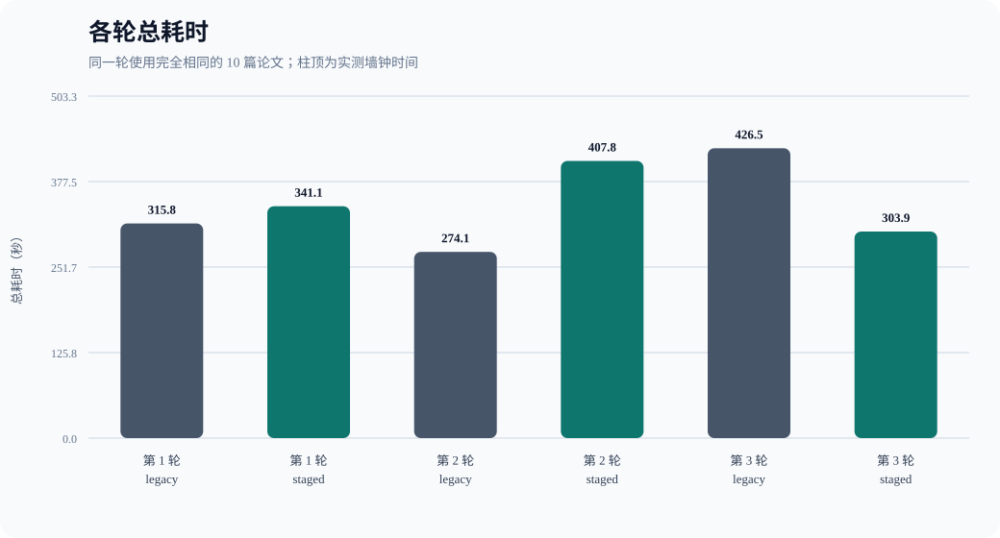
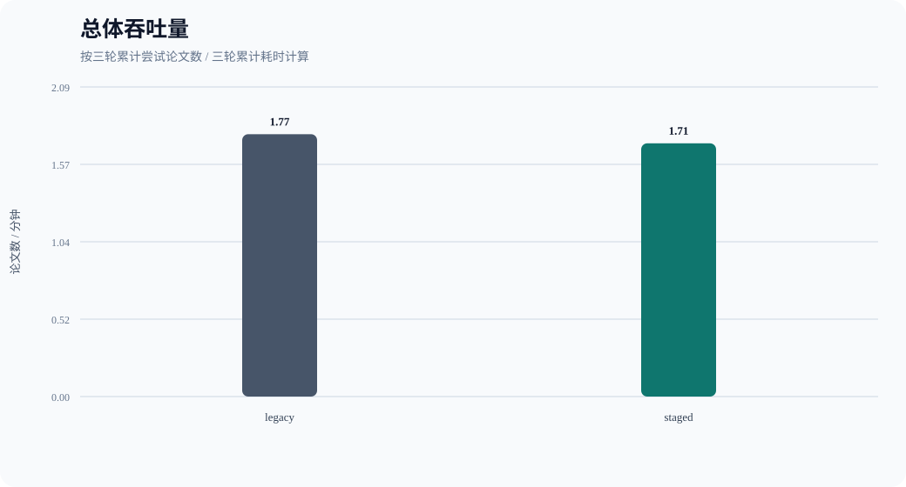
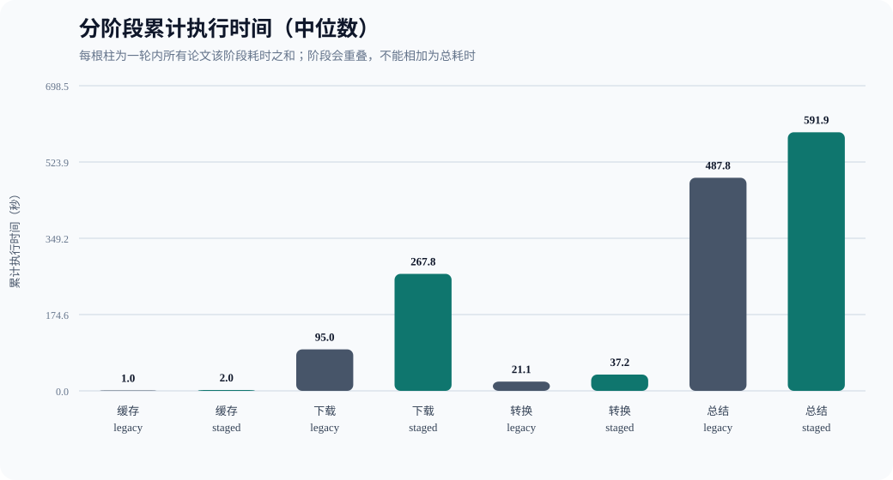
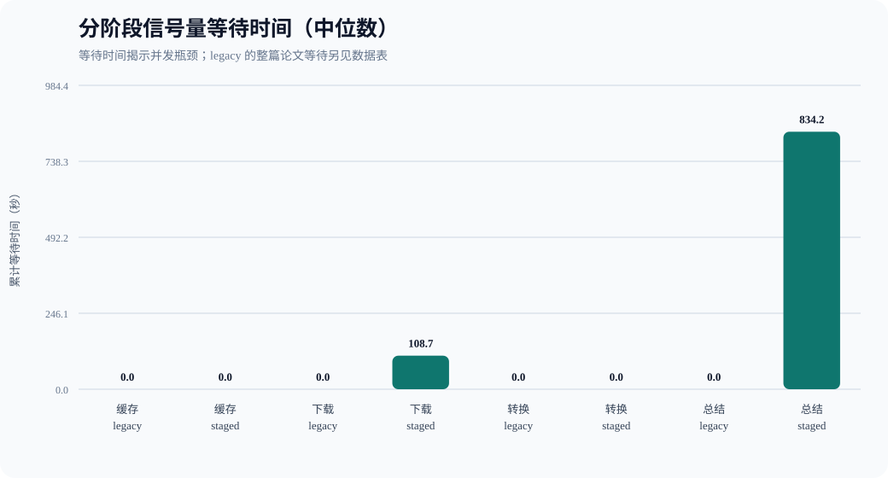

# 论文流水线并发性能对比报告

> 本报告由真实 Benchmark 自动生成；所有数字均来自本次运行，未执行的实验不会生成结果。



- 生成时间：2026-10-23T09:39:15.856414+00:00
- 测试集：10 篇公开论文混合来源固定测试集
- 测试集哈希：`3faa6767c4cf818d396fe07986e6c3a70cecc883b6485cc2082997e53bea0e53`
- 论文数量：10（arXiv 5 篇，CVF Open Access 2 篇，ACL Anthology 1 篇，PMLR 1 篇，NeurIPS Proceedings 1 篇）
- 计时：`time.perf_counter()` 单调时钟
- 执行顺序：两种模式严格串行；偶数轮反转模式顺序以降低先后顺序偏差

## 修订说明

- 原第 2 轮 legacy 有 1 篇下载失败；按约定，以本次 10/10 成功的独立 legacy 补跑替换该轮后重新统计。
- 被替换记录：`D:\BUAA\homework\26-27-Autumn\ai\BUAA_Paper_Research_Agent\outputs\benchmarks\benchmark-20261023-164459-572400\benchmark_results.json`
- 补跑记录：`D:\BUAA\homework\26-27-Autumn\ai\BUAA_Paper_Research_Agent\outputs\benchmarks\legacy-reruns\benchmark-20261023-173345-558200\benchmark_results.json`
- 原始结果和失败样本均保留，未被覆盖或删除。

## 测试集

| ID | 论文 | 来源 | PDF |
|---|---|---|---|
| A1 | Attention Is All You Need | arXiv | [公开链接](https://arxiv.org/pdf/1706.03762) |
| A2 | LoRA: Low-Rank Adaptation of Large Language Models | arXiv | [公开链接](https://arxiv.org/pdf/2106.09685) |
| A3 | Denoising Diffusion Probabilistic Models | arXiv | [公开链接](https://arxiv.org/pdf/2006.11239) |
| A4 | Retrieval-Augmented Generation for Knowledge-Intensive NLP Tasks | arXiv | [公开链接](https://arxiv.org/pdf/2005.11401) |
| A5 | ReAct: Synergizing Reasoning and Acting in Language Models | arXiv | [公开链接](https://arxiv.org/pdf/2210.03629) |
| O1 | Deep Residual Learning for Image Recognition | CVF Open Access | [公开链接](https://openaccess.thecvf.com/content_cvpr_2016/papers/He_Deep_Residual_Learning_CVPR_2016_paper.pdf) |
| O2 | Mask R-CNN | CVF Open Access | [公开链接](https://openaccess.thecvf.com/content_ICCV_2017/papers/He_Mask_R-CNN_ICCV_2017_paper.pdf) |
| O3 | BERT: Pre-training of Deep Bidirectional Transformers for Language Understanding | ACL Anthology | [公开链接](https://aclanthology.org/N19-1423.pdf) |
| O4 | Batch Normalization: Accelerating Deep Network Training by Reducing Internal Covariate Shift | PMLR | [公开链接](https://proceedings.mlr.press/v37/ioffe15.pdf) |
| O5 | Distributed Representations of Words and Phrases and their Compositionality | NeurIPS Proceedings | [公开链接](https://papers.nips.cc/paper_files/paper/2013/file/9aa42b31882ec039965f3c4923ce901b-Paper.pdf) |

## 配置

| 参数 | 值 |
|---|---:|
| legacy_concurrency | 2 |
| download_concurrency | 4 |
| convert_concurrency | 1 |
| summary_concurrency | 2 |
| max_in_flight | 8 |

模型、Prompt、重试与超时配置在所有轮次保持一致：

```json
{
  "LLM_BACKEND": "openai",
  "LLM_BASE_URL": "https://api.deepseek.com/v1",
  "LLM_MODEL": "deepseek-flash",
  "LLM_MAX_TOKENS": "8192",
  "LLM_CONTEXT_TOKENS": "32768",
  "LLM_TEMPERATURE": "",
  "LLM_TOP_P": "",
  "LLM_TOP_K": "",
  "LLM_ENABLE_THINKING": "",
  "SUMMARY_CHUNK_CHARS": "",
  "SUMMARY_NOTE_MAX_TOKENS": "",
  "SUMMARY_FINAL_MAX_TOKENS": "",
  "PDF_LAYOUT_MODE": "",
  "llm_retry_policy": "transport/429/5xx：最多 3 次，退避 1s/2s",
  "llm_timeout_seconds": 300,
  "pdf_timeout_seconds": 60,
  "task_agent.py_sha256": "5f4560c34d41b4e6e0083679a3bd7b330da28bf2f225ad61fc2d4616abf63596",
  "llm.py_sha256": "2bf147307fddb112e482867a8ae20b6073aaf243129d570b7d2bf0911778a9ff"
}
```

## 总体结果

| 模式 | 轮数 | 总耗时(s) | 中位数(s) | 波动范围(s) | 吞吐量(篇/s) | 成功/尝试 | 失败率 |
|---|---:|---:|---:|---:|---:|---:|---:|
| legacy | 3 | 1016.399 | 315.799 | 274.050–426.550 | 0.0295 | 30/30 | 0.00% |
| staged | 3 | 1052.899 | 341.109 | 303.943–407.847 | 0.0285 | 30/30 | 0.00% |



计算公式：

- 耗时改善率 = `(legacy 中位耗时 - staged 中位耗时) / legacy 中位耗时 × 100%`。
- 失败率 = `最终失败论文数 / 尝试处理论文总数 × 100%`；重试后最终成功不计失败。

## 各轮结果

| 轮次 | 模式 | 总耗时(s) | 吞吐量(篇/s) | 成功 | 失败 | 失败率 | 输出目录 |
|---:|---|---:|---:|---:|---:|---:|---|
| 1 | legacy | 315.799 | 0.0317 | 10 | 0 | 0.00% | `D:\BUAA\homework\26-27-Autumn\ai\BUAA_Paper_Research_Agent\outputs\benchmarks\benchmark-20261023-164459-572400\01-legacy-repeat-1\artifacts` |
| 1 | staged | 341.109 | 0.0293 | 10 | 0 | 0.00% | `D:\BUAA\homework\26-27-Autumn\ai\BUAA_Paper_Research_Agent\outputs\benchmarks\benchmark-20261023-164459-572400\02-staged-repeat-1\artifacts` |
| 2 | staged | 407.847 | 0.0245 | 10 | 0 | 0.00% | `D:\BUAA\homework\26-27-Autumn\ai\BUAA_Paper_Research_Agent\outputs\benchmarks\benchmark-20261023-164459-572400\03-staged-repeat-2\artifacts` |
| 2 | legacy | 274.050 | 0.0365 | 10 | 0 | 0.00% | `D:\BUAA\homework\26-27-Autumn\ai\BUAA_Paper_Research_Agent\outputs\benchmarks\legacy-reruns\benchmark-20261023-173345-558200\01-legacy-repeat-1\artifacts` |
| 3 | legacy | 426.550 | 0.0234 | 10 | 0 | 0.00% | `D:\BUAA\homework\26-27-Autumn\ai\BUAA_Paper_Research_Agent\outputs\benchmarks\benchmark-20261023-164459-572400\05-legacy-repeat-3\artifacts` |
| 3 | staged | 303.943 | 0.0329 | 10 | 0 | 0.00% | `D:\BUAA\homework\26-27-Autumn\ai\BUAA_Paper_Research_Agent\outputs\benchmarks\benchmark-20261023-164459-572400\06-staged-repeat-3\artifacts` |

## 单篇论文耗时

| 轮次 | 模式 | 论文 | 状态 | 总耗时(s) | 错误 |
|---:|---|---|---|---:|---|
| 1 | legacy | A1 | ok | 39.979 | — |
| 1 | legacy | A2 | ok | 79.567 | — |
| 1 | legacy | A3 | ok | 78.067 | — |
| 1 | legacy | A4 | ok | 53.491 | — |
| 1 | legacy | A5 | ok | 74.192 | — |
| 1 | legacy | O1 | ok | 46.344 | — |
| 1 | legacy | O2 | ok | 85.738 | — |
| 1 | legacy | O3 | ok | 70.356 | — |
| 1 | legacy | O4 | ok | 53.187 | — |
| 1 | legacy | O5 | ok | 44.719 | — |
| 1 | staged | A1 | ok | 56.918 | — |
| 1 | staged | A2 | ok | 102.805 | — |
| 1 | staged | A3 | ok | 235.521 | — |
| 1 | staged | A4 | ok | 275.184 | — |
| 1 | staged | A5 | ok | 341.073 | — |
| 1 | staged | O1 | ok | 164.044 | — |
| 1 | staged | O2 | ok | 130.006 | — |
| 1 | staged | O3 | ok | 185.572 | — |
| 1 | staged | O4 | ok | 156.737 | — |
| 1 | staged | O5 | ok | 200.804 | — |
| 2 | staged | A1 | ok | 59.429 | — |
| 2 | staged | A2 | ok | 143.538 | — |
| 2 | staged | A3 | ok | 342.493 | — |
| 2 | staged | A4 | ok | 93.588 | — |
| 2 | staged | A5 | ok | 407.708 | — |
| 2 | staged | O1 | ok | 197.315 | — |
| 2 | staged | O2 | ok | 206.671 | — |
| 2 | staged | O3 | ok | 306.430 | — |
| 2 | staged | O4 | ok | 191.510 | — |
| 2 | staged | O5 | ok | 185.859 | — |
| 2 | legacy | A1 | ok | 35.745 | — |
| 2 | legacy | A2 | ok | 69.215 | — |
| 2 | legacy | A3 | ok | 64.633 | — |
| 2 | legacy | A4 | ok | 42.103 | — |
| 2 | legacy | A5 | ok | 91.435 | — |
| 2 | legacy | O1 | ok | 36.454 | — |
| 2 | legacy | O2 | ok | 91.149 | — |
| 2 | legacy | O3 | ok | 58.270 | — |
| 2 | legacy | O4 | ok | 35.088 | — |
| 2 | legacy | O5 | ok | 22.018 | — |
| 3 | legacy | A1 | ok | 117.739 | — |
| 3 | legacy | A2 | ok | 171.903 | — |
| 3 | legacy | A3 | ok | 87.121 | — |
| 3 | legacy | A4 | ok | 74.587 | — |
| 3 | legacy | A5 | ok | 95.120 | — |
| 3 | legacy | O1 | ok | 56.452 | — |
| 3 | legacy | O2 | ok | 89.737 | — |
| 3 | legacy | O3 | ok | 72.119 | — |
| 3 | legacy | O4 | ok | 51.483 | — |
| 3 | legacy | O5 | ok | 21.126 | — |
| 3 | staged | A1 | ok | 44.205 | — |
| 3 | staged | A2 | ok | 108.652 | — |
| 3 | staged | A3 | ok | 222.764 | — |
| 3 | staged | A4 | ok | 244.169 | — |
| 3 | staged | A5 | ok | 303.933 | — |
| 3 | staged | O1 | ok | 47.651 | — |
| 3 | staged | O2 | ok | 121.158 | — |
| 3 | staged | O3 | ok | 163.693 | — |
| 3 | staged | O4 | ok | 117.536 | — |
| 3 | staged | O5 | ok | 139.135 | — |

## 阶段执行、等待与失败

以下时间为每轮各论文阶段时间之和；阶段会重叠，因此不能相加得到总耗时。





| 轮次 | 模式 | 阶段 | 执行(s) | 等待(s) | 尝试 | 阶段失败 |
|---:|---|---|---:|---:|---:|---:|
| 1 | legacy | whole-paper scheduler | — | 1150.398 | 10 | 0 |
| 1 | legacy | cache | 2.160 | 0.000 | 20 | 0 |
| 1 | legacy | download | 95.036 | 0.000 | 10 | 0 |
| 1 | legacy | convert | 36.299 | 4.087 | 10 | 0 |
| 1 | legacy | summary | 487.756 | 0.000 | 10 | 0 |
| 1 | staged | whole-paper scheduler | — | 0.000 | 10 | 0 |
| 1 | staged | cache | 2.020 | 0.000 | 20 | 0 |
| 1 | staged | download | 267.818 | 108.745 | 10 | 0 |
| 1 | staged | convert | 43.757 | 0.000 | 10 | 0 |
| 1 | staged | summary | 591.941 | 834.209 | 10 | 0 |
| 2 | staged | whole-paper scheduler | — | 0.000 | 10 | 0 |
| 2 | staged | cache | 4.688 | 0.000 | 20 | 0 |
| 2 | staged | download | 364.706 | 117.960 | 10 | 0 |
| 2 | staged | convert | 37.196 | 0.029 | 10 | 0 |
| 2 | staged | summary | 703.186 | 906.539 | 10 | 0 |
| 2 | legacy | whole-paper scheduler | — | 1040.206 | 10 | 0 |
| 2 | legacy | cache | 1.019 | 0.000 | 20 | 0 |
| 2 | legacy | download | 64.838 | 0.000 | 10 | 0 |
| 2 | legacy | convert | 17.132 | 0.000 | 10 | 0 |
| 2 | legacy | summary | 463.026 | 0.000 | 10 | 0 |
| 3 | legacy | whole-paper scheduler | — | 1819.057 | 10 | 0 |
| 3 | legacy | cache | 0.426 | 0.000 | 20 | 0 |
| 3 | legacy | download | 278.208 | 0.000 | 10 | 0 |
| 3 | legacy | convert | 21.096 | 0.000 | 10 | 0 |
| 3 | legacy | summary | 537.474 | 0.000 | 10 | 0 |
| 3 | staged | whole-paper scheduler | — | 0.000 | 10 | 0 |
| 3 | staged | cache | 1.425 | 0.000 | 20 | 0 |
| 3 | staged | download | 205.919 | 57.263 | 10 | 0 |
| 3 | staged | convert | 16.760 | 0.000 | 10 | 0 |
| 3 | staged | summary | 532.378 | 699.060 | 10 | 0 |

## 结论

按两种模式总耗时中位数计算，staged 相对 legacy 的耗时增加 **8.01%**。
在本测试集与当前外部服务状态下，分阶段并发未带来耗时改善。
未观察到 staged 的最终失败率上升。

最终失败仅按论文最终状态统计；中途发生阶段失败或内部重试、但最终成功的论文不会计入最终失败。

## 实验限制

- 结果受论文站点、API 服务商负载、网络质量和限流策略影响。
- arXiv PDF 下载仍严格串行并保持至少 3.1 秒间隔，因此下载并发不会绕过其限速。
- 每轮使用独立输出与缓存；服务商侧缓存、连接预热或动态路由无法由本脚本清除。
- 若服务商动态路由实际承载模型，请将这种变化视为外部实验变量。
- 本报告只测量 PDF 下载、Markdown 转换和逐篇总结，不包含检索、筛选和综合报告生成。
- 修订版第 2 轮 legacy 来自一次后续独立补跑；原始失败轮次仍保存在原始结果中。
