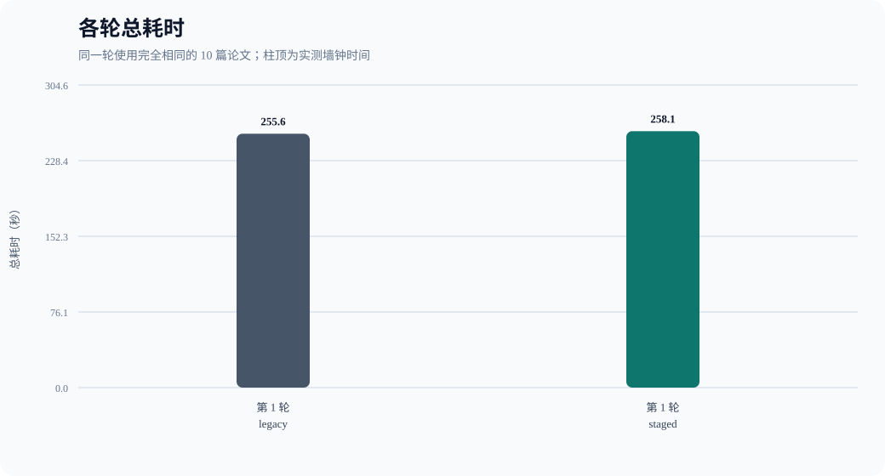
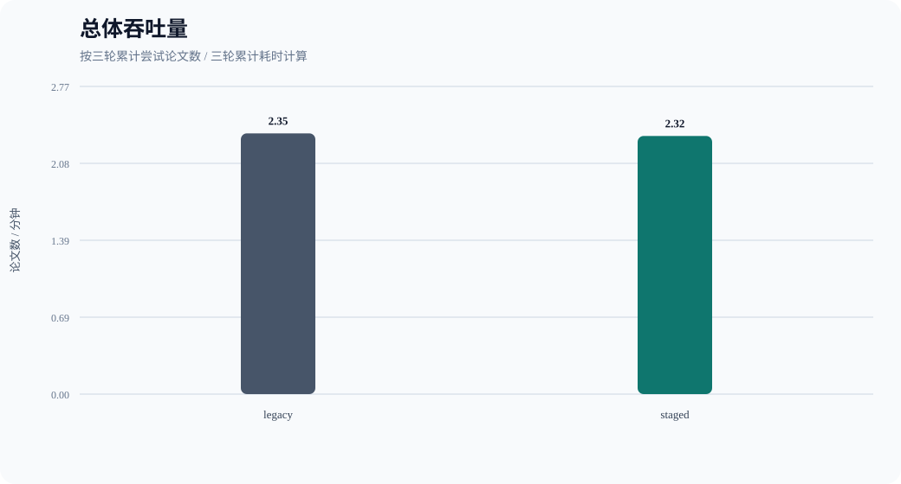
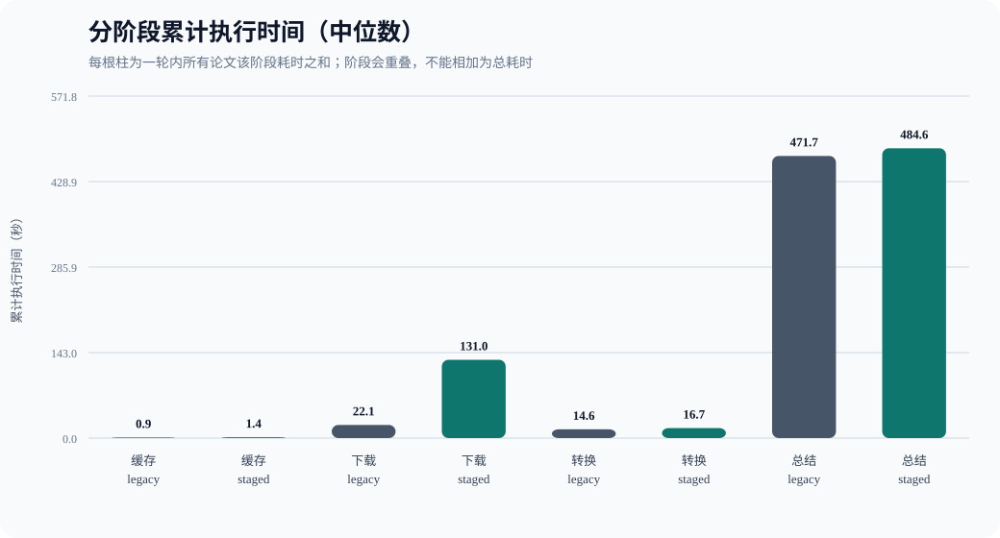
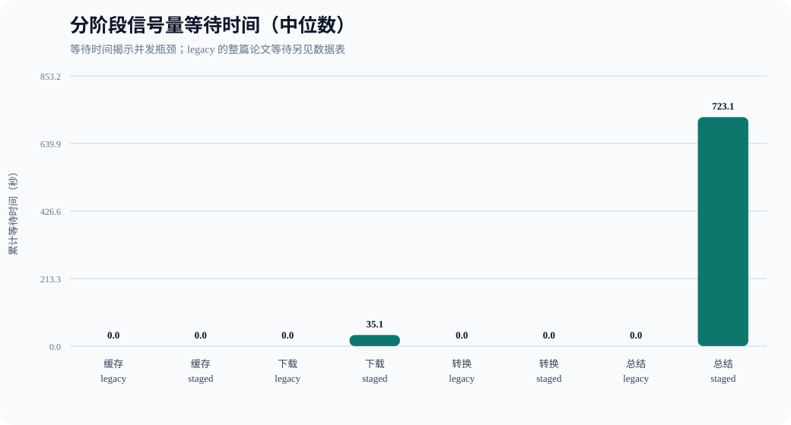

# 论文流水线并发性能对比报告

> 本报告由真实 Benchmark 自动生成；所有数字均来自本次运行，未执行的实验不会生成结果。



- 生成时间：2026-10-23T09:51:39.508197+00:00
- 测试集：10 篇公开论文混合来源固定测试集
- 测试集哈希：`3faa6767c4cf818d396fe07986e6c3a70cecc883b6485cc2082997e53bea0e53`
- 论文数量：10（arXiv 5 篇，CVF Open Access 2 篇，ACL Anthology 1 篇，PMLR 1 篇，NeurIPS Proceedings 1 篇）
- 计时：`time.perf_counter()` 单调时钟
- 执行顺序：两种模式严格串行；偶数轮反转模式顺序以降低先后顺序偏差

## 测试集

| ID | 论文 | 来源 | PDF |
|---|---|---|---|
| A1 | Attention Is All You Need | arXiv | [公开链接](https://arxiv.org/pdf/1706.03762) |
| A2 | LoRA: Low-Rank Adaptation of Large Language Models | arXiv | [公开链接](https://arxiv.org/pdf/2106.09685) |
| A3 | Denoising Diffusion Probabilistic Models | arXiv | [公开链接](https://arxiv.org/pdf/2006.11239) |
| A4 | Retrieval-Augmented Generation for Knowledge-Intensive NLP Tasks | arXiv | [公开链接](https://arxiv.org/pdf/2005.11401) |
| A5 | ReAct: Synergizing Reasoning and Acting in Language Models | arXiv | [公开链接](https://arxiv.org/pdf/2210.03629) |
| O1 | Deep Residual Learning for Image Recognition | CVF Open Access | [公开链接](https://openaccess.thecvf.com/content_cvpr_2016/papers/He_Deep_Residual_Learning_CVPR_2016_paper.pdf) |
| O2 | Mask R-CNN | CVF Open Access | [公开链接](https://openaccess.thecvf.com/content_ICCV_2017/papers/He_Mask_R-CNN_ICCV_2017_paper.pdf) |
| O3 | BERT: Pre-training of Deep Bidirectional Transformers for Language Understanding | ACL Anthology | [公开链接](https://aclanthology.org/N19-1423.pdf) |
| O4 | Batch Normalization: Accelerating Deep Network Training by Reducing Internal Covariate Shift | PMLR | [公开链接](https://proceedings.mlr.press/v37/ioffe15.pdf) |
| O5 | Distributed Representations of Words and Phrases and their Compositionality | NeurIPS Proceedings | [公开链接](https://papers.nips.cc/paper_files/paper/2013/file/9aa42b31882ec039965f3c4923ce901b-Paper.pdf) |

## 配置

| 参数 | 值 |
|---|---:|
| legacy_concurrency | 2 |
| download_concurrency | 4 |
| convert_concurrency | 1 |
| summary_concurrency | 2 |
| max_in_flight | 8 |

模型、Prompt、重试与超时配置在所有轮次保持一致：

```json
{
  "LLM_BACKEND": "openai",
  "LLM_BASE_URL": "https://api.deepseek.com/v1",
  "LLM_MODEL": "deepseek-flash",
  "LLM_MAX_TOKENS": "8192",
  "LLM_CONTEXT_TOKENS": "32768",
  "LLM_TEMPERATURE": "",
  "LLM_TOP_P": "",
  "LLM_TOP_K": "",
  "LLM_ENABLE_THINKING": "",
  "SUMMARY_CHUNK_CHARS": "",
  "SUMMARY_NOTE_MAX_TOKENS": "",
  "SUMMARY_FINAL_MAX_TOKENS": "",
  "PDF_LAYOUT_MODE": "",
  "llm_retry_policy": "transport/429/5xx：最多 3 次，退避 1s/2s",
  "llm_timeout_seconds": 300,
  "pdf_timeout_seconds": 60,
  "task_agent.py_sha256": "5f4560c34d41b4e6e0083679a3bd7b330da28bf2f225ad61fc2d4616abf63596",
  "llm.py_sha256": "2bf147307fddb112e482867a8ae20b6073aaf243129d570b7d2bf0911778a9ff"
}
```

## 总体结果

| 模式 | 轮数 | 总耗时(s) | 中位数(s) | 波动范围(s) | 吞吐量(篇/s) | 成功/尝试 | 失败率 |
|---|---:|---:|---:|---:|---:|---:|---:|
| legacy | 1 | 255.593 | 255.593 | 255.593–255.593 | 0.0391 | 10/10 | 0.00% |
| staged | 1 | 258.113 | 258.113 | 258.113–258.113 | 0.0387 | 10/10 | 0.00% |



计算公式：

- 耗时改善率 = `(legacy 中位耗时 - staged 中位耗时) / legacy 中位耗时 × 100%`。
- 失败率 = `最终失败论文数 / 尝试处理论文总数 × 100%`；重试后最终成功不计失败。

## 各轮结果

| 轮次 | 模式 | 总耗时(s) | 吞吐量(篇/s) | 成功 | 失败 | 失败率 | 输出目录 |
|---:|---|---:|---:|---:|---:|---:|---|
| 1 | legacy | 255.593 | 0.0391 | 10 | 0 | 0.00% | `D:\BUAA\homework\26-27-Autumn\ai\BUAA_Paper_Research_Agent\outputs\benchmarks\candidate-runs\benchmark-20261023-174305-035000\01-legacy-repeat-1\artifacts` |
| 1 | staged | 258.113 | 0.0387 | 10 | 0 | 0.00% | `D:\BUAA\homework\26-27-Autumn\ai\BUAA_Paper_Research_Agent\outputs\benchmarks\candidate-runs\benchmark-20261023-174305-035000\02-staged-repeat-1\artifacts` |

## 单篇论文耗时

| 轮次 | 模式 | 论文 | 状态 | 总耗时(s) | 错误 |
|---:|---|---|---|---:|---|
| 1 | legacy | A1 | ok | 30.894 | — |
| 1 | legacy | A2 | ok | 54.862 | — |
| 1 | legacy | A3 | ok | 40.371 | — |
| 1 | legacy | A4 | ok | 53.440 | — |
| 1 | legacy | A5 | ok | 73.865 | — |
| 1 | legacy | O1 | ok | 43.231 | — |
| 1 | legacy | O2 | ok | 81.865 | — |
| 1 | legacy | O3 | ok | 69.028 | — |
| 1 | legacy | O4 | ok | 34.997 | — |
| 1 | legacy | O5 | ok | 26.802 | — |
| 1 | staged | A1 | ok | 32.808 | — |
| 1 | staged | A2 | ok | 63.988 | — |
| 1 | staged | A3 | ok | 177.871 | — |
| 1 | staged | A4 | ok | 217.242 | — |
| 1 | staged | A5 | ok | 258.100 | — |
| 1 | staged | O1 | ok | 68.581 | — |
| 1 | staged | O2 | ok | 133.051 | — |
| 1 | staged | O3 | ok | 128.330 | — |
| 1 | staged | O4 | ok | 136.943 | — |
| 1 | staged | O5 | ok | 175.128 | — |

## 阶段执行、等待与失败

以下时间为每轮各论文阶段时间之和；阶段会重叠，因此不能相加得到总耗时。





| 轮次 | 模式 | 阶段 | 执行(s) | 等待(s) | 尝试 | 阶段失败 |
|---:|---|---|---:|---:|---:|---:|
| 1 | legacy | whole-paper scheduler | — | 923.705 | 10 | 0 |
| 1 | legacy | cache | 0.895 | 0.000 | 20 | 0 |
| 1 | legacy | download | 22.069 | 0.000 | 10 | 0 |
| 1 | legacy | convert | 14.580 | 0.000 | 10 | 0 |
| 1 | legacy | summary | 471.704 | 0.000 | 10 | 0 |
| 1 | staged | whole-paper scheduler | — | 0.000 | 10 | 0 |
| 1 | staged | cache | 1.441 | 0.000 | 20 | 0 |
| 1 | staged | download | 130.995 | 35.054 | 10 | 0 |
| 1 | staged | convert | 16.699 | 0.020 | 10 | 0 |
| 1 | staged | summary | 484.617 | 723.077 | 10 | 0 |

## 结论

按两种模式总耗时中位数计算，staged 相对 legacy 的耗时增加 **0.99%**。
在本测试集与当前外部服务状态下，分阶段并发未带来耗时改善。
未观察到 staged 的最终失败率上升。

最终失败仅按论文最终状态统计；中途发生阶段失败或内部重试、但最终成功的论文不会计入最终失败。

## 实验限制

- 结果受论文站点、API 服务商负载、网络质量和限流策略影响。
- arXiv PDF 下载仍严格串行并保持至少 3.1 秒间隔，因此下载并发不会绕过其限速。
- 每轮使用独立输出与缓存；服务商侧缓存、连接预热或动态路由无法由本脚本清除。
- 若服务商动态路由实际承载模型，请将这种变化视为外部实验变量。
- 本报告只测量 PDF 下载、Markdown 转换和逐篇总结，不包含检索、筛选和综合报告生成。
