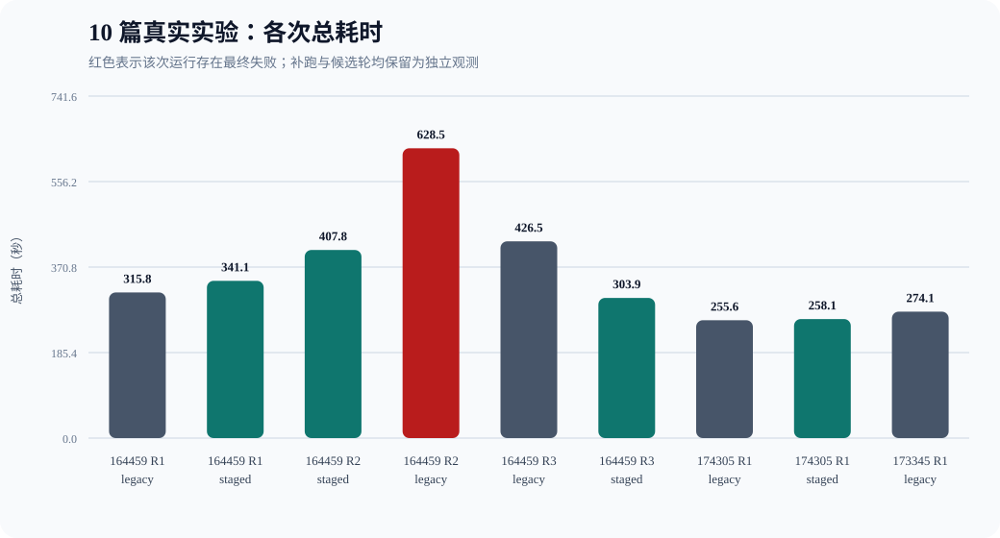
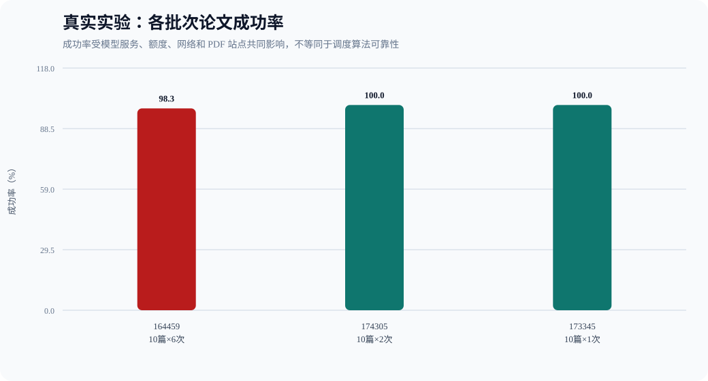
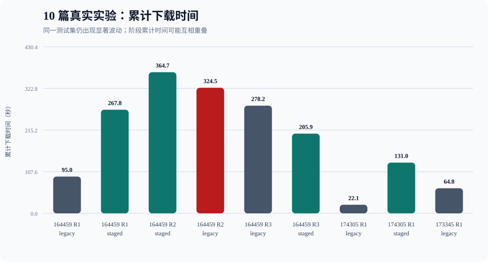

# 真实环境 Benchmark 实验记录与影响因素分析

==源文件位置：BUAA_Paper_Research_Agent\outputs\benchmarks\real-experiment-analysis==

> **实验结论摘要：本项目完成了多批次真实端到端 Benchmark，覆盖公共 PDF 下载、PDF 转换和模型 API 总结。实验验证了系统能够在真实服务环境中运行，同时观察到公共论文站点、网络链路和模型 API 状态会显著影响耗时与成功率。因而，真实实验主要用于评估工程表现与外部波动，可控模拟实验则用于进一步剥离外部变量、分析调度算法本身的贡献。**

## 1. 数据范围与统计原则

- 独立真实实验批次：3 个。
- 独立流水线运行：9 次。
- 论文处理尝试：90 次；最终成功 89 次，失败 1 次。
- 所有纳入统计的真实批次均使用同一套 10 篇固定混合来源测试集。
- 所有真实运行均使用独立输出目录与本地缓存，避免复用上一轮下载或转换结果。
- `benchmark_results_revised.json` 是以成功补跑替换失败轮次得到的派生数据，不作为新的独立运行重复计数。
- 失败运行完整保留。失败可能因重试/超时而异常变慢，也可能因提前终止而异常变快，因此不能只依据其墙钟时间判断调度性能。

## 2. 独立真实实验批次

| 批次 | 论文数 | API/模型 | 流水线运行 | 成功/尝试 | 失败率 | 耗时范围 |
|---|---:|---|---:|---:|---:|---:|
| `benchmark-20261023-164459-572400` | 10 | DeepSeek / `deepseek-flash` | 6 | 59/60 | 1.67% | 303.943–628.487s |
| `benchmark-20261023-174305-035000` | 10 | DeepSeek / `deepseek-flash` | 2 | 20/20 | 0.00% | 255.593–258.113s |
| `benchmark-20261023-173345-558200` | 10 | DeepSeek / `deepseek-flash` | 1 | 10/10 | 0.00% | 274.050–274.050s |

## 3. 全部独立运行台账

| 批次 | 测试集 | 轮次 | 模式 | 总耗时(s) | 成功/尝试 | 失败类型 |
|---|---:|---:|---|---:|---:|---|
| `benchmark-20261023-164459-572400` | 10 篇 | 1 | legacy | 315.799 | 10/10 | — |
| `benchmark-20261023-164459-572400` | 10 篇 | 1 | staged | 341.109 | 10/10 | — |
| `benchmark-20261023-164459-572400` | 10 篇 | 2 | staged | 407.847 | 10/10 | — |
| `benchmark-20261023-164459-572400` | 10 篇 | 2 | legacy | 628.487 | 9/10 | PDF 下载连接失败 |
| `benchmark-20261023-164459-572400` | 10 篇 | 3 | legacy | 426.550 | 10/10 | — |
| `benchmark-20261023-164459-572400` | 10 篇 | 3 | staged | 303.943 | 10/10 | — |
| `benchmark-20261023-174305-035000` | 10 篇 | 1 | legacy | 255.593 | 10/10 | — |
| `benchmark-20261023-174305-035000` | 10 篇 | 1 | staged | 258.113 | 10/10 | — |
| `benchmark-20261023-173345-558200` | 10 篇 | 1 | legacy | 274.050 | 10/10 | — |

## 4. 10 篇正式测试的阶段数据

以下累计阶段时间是 10 篇论文对应阶段耗时之和。不同论文及不同阶段可以重叠，因此累计时间不能直接相加得到墙钟时间。

| 批次 | 轮次 | 模式 | 总耗时 | 下载累计 | 下载等待 | 总结累计 | 总结等待 | 成功 |
|---|---:|---|---:|---:|---:|---:|---:|---:|
| `benchmark-20261023-164459-572400` | 1 | legacy | 315.799s | 95.036s | 0.000s | 487.756s | 0.000s | 10/10 |
| `benchmark-20261023-164459-572400` | 1 | staged | 341.109s | 267.818s | 108.745s | 591.941s | 834.209s | 10/10 |
| `benchmark-20261023-164459-572400` | 2 | staged | 407.847s | 364.706s | 117.960s | 703.186s | 906.539s | 10/10 |
| `benchmark-20261023-164459-572400` | 2 | legacy | 628.487s | 324.479s | 0.000s | 892.411s | 0.000s | 9/10 |
| `benchmark-20261023-164459-572400` | 3 | legacy | 426.550s | 278.208s | 0.000s | 537.474s | 0.000s | 10/10 |
| `benchmark-20261023-164459-572400` | 3 | staged | 303.943s | 205.919s | 57.263s | 532.378s | 699.060s | 10/10 |
| `benchmark-20261023-174305-035000` | 1 | legacy | 255.593s | 22.069s | 0.000s | 471.704s | 0.000s | 10/10 |
| `benchmark-20261023-174305-035000` | 1 | staged | 258.113s | 130.995s | 35.054s | 484.617s | 723.077s | 10/10 |
| `benchmark-20261023-173345-558200` | 1 | legacy | 274.050s | 64.838s | 0.000s | 463.026s | 0.000s | 10/10 |

### 直接观察

- 同一 10 篇测试集中，legacy 累计下载时间从 22.069s 到 324.479s，相差 14.70 倍。
- staged 累计下载时间从 130.995s 到 364.706s，相差 2.78 倍。
- legacy 累计 API 总结时间从 463.026s 到 892.411s，相差 1.93 倍；staged 则从 484.617s 到 703.186s，相差 1.45 倍。
- 即使只看全部成功的 legacy，整轮耗时仍从 255.593s 到 426.550s，相差 1.67 倍。
- 全部 staged 整轮耗时从 258.113s 到 407.847s，相差 1.58 倍。
- 原三轮第 2 次 legacy 的 O5（NeurIPS PDF）出现 `Server disconnected without sending a response`，说明公开 PDF 站点本身可以改变失败率和整轮耗时。

## 5. 结论对数据选择高度敏感

| 统计口径 | Legacy 中位数 | Staged 中位数 | 结论 |
|---|---:|---:|---|
| 原始 10 篇三轮（保留一次 legacy 失败） | 426.550s | 341.109s | staged 快 20.03% |
| 用 274.050s 成功补跑替换失败轮次 | 315.799s | 341.109s | staged 慢 8.01% |
| 最新独立候选对照轮 | 255.593s | 258.113s | staged 慢 0.99%，基本持平 |
| 原始三轮再追加候选轮 | 371.174s | 322.526s | staged 快 13.11% |
| 修订三轮再追加候选轮 | 294.925s | 322.526s | staged 慢 9.36% |

同一批真实数据只因“是否保留失败轮次、是否用成功补跑替换、是否追加候选轮”就能使结论由加速变为减速。因此，不应选择性保留最符合预期的数据；原始结果、补跑结果和修订规则必须同时披露。

## 6. 真实实验中的显著干扰变量

1. **公共 PDF 站点与下载链路。** arXiv 有强制串行限速；CVF、ACL、PMLR、NeurIPS 等站点的响应速度、连接复用、CDN 节点和断连情况随时间变化。下载并发参数不等于实际可获得的下载带宽。
2. **模型 API 服务状态。** 服务端负载、排队、动态路由、限流、额度、429、网关错误和响应格式变化都会影响耗时与成功率。
3. **请求内容差异。** 不同论文正文长度和分块数量不同，会产生不同 token 数量、模型推理时间和重试概率。
4. **模式执行时间窗口不同。** 两种模式严格串行以避免互相抢占资源，但因此必然处于不同的网络/API 时间窗口。交替顺序可以缓解先后偏差，不能消除服务端状态漂移。
5. **失败和重试改变耗时含义。** 失败可能等待完整超时后才返回，也可能快速失败；所以“失败得快”不能视为性能提升。重试后成功则会增加耗时但不计为最终失败。
6. **缓存只能局部控制。** 每轮清空本地缓存可以避免本地复用，但无法清除服务商 CDN、API 连接预热、DNS、代理节点或服务端缓存。
7. **本机与代理环境。** CPU/线程调度、后台负载、Clash/TUN 或显式代理路由可能改变下载和 API 往返时间。
8. **阶段时间存在重叠。** 各论文阶段累计时间与信号量等待时间用于定位瓶颈，但不能简单相加后与墙钟时间比较。

## 7. 真实实验与可控模拟实验的互补设计

真实实验回答的是“系统在当时网络和服务状态下表现如何”，而模拟实验回答的是“在外部延迟固定时，调度算法本身是否减少了队头阻塞”。只有后者能够进行相对清晰的因果归因。

模拟实验复用真实 `process_papers()`、worker pool 和信号量，只把下载、转换、API 总结替换为固定延迟；不访问网络、不使用 API、不产生限流和随机断连。其 20 轮中位数结果为：

| 模拟场景 | Legacy 中位数 | Staged 中位数 | 改善率 |
|---|---:|---:|---:|
| 均衡流水线 | 1.104s | 0.768s | 30.44% |
| API 主导 | 1.396s | 1.176s | 15.78% |
| 下载主导 | 1.063s | 0.452s | 57.46% |

模拟结果证明：当下载、转换与总结能够重叠时，分阶段调度本身可以提高吞吐量；真实结果未稳定复现同等收益，主要说明当前真实系统受外部瓶颈和噪声支配，而不是否定调度机制正确性。

## 8. 证据边界与解释范围

### 真实与模拟数据共同支持的结论

- staged 的分阶段并发上限确实生效，调度结构能够消除整篇论文占用同一信号量的问题。
- 在可控延迟下，staged 在三种模拟负载中均提高了吞吐量，且下载主导场景收益最大。
- 真实系统的网络、PDF 站点与模型 API 是显著干扰变量，必须与算法调度效果分开讨论。

### 需要谨慎解释的内容

- staged 的真实加速比例随网络与服务状态变化，不宜外推为所有环境下固定的 20.03%、30.44% 或其他单一数值。
- API/PDF 下载失败需要结合错误类型解释；失败运行的耗时也不能直接等同于正常完成任务的性能。
- 成功补跑可以作为补充观测，但应同时展示原始结果与替换规则，以保证数据过程可追溯。
- 下载并发设置为 4 表示调度上限，并不意味着 arXiv 可以实际并行下载 4；arXiv 限速仍然优先。

## 9. 综合实验结论

> 分阶段并发在架构上消除了整篇论文级信号量造成的队头阻塞，并在固定延迟的可控模拟中获得 15.78%～57.46% 的中位耗时改善。多批真实端到端实验进一步验证了系统的可运行性，同时表明公共 PDF 下载速度、arXiv 限速、模型 API 负载、限流、重试和网络故障会产生显著波动。综合来看，模拟实验用于识别调度算法的独立贡献，真实实验用于评估该优化在工程环境中的实际表现与适用条件。

## 10. 数据溯源

独立批次原始文件：

- `BUAA_Paper_Research_Agent\outputs\benchmarks\benchmark-20261023-164459-572400\benchmark_results.json`
- `BUAA_Paper_Research_Agent\outputs\benchmarks\candidate-runs\benchmark-20261023-174305-035000\benchmark_results.json`
- `BUAA_Paper_Research_Agent\outputs\benchmarks\legacy-reruns\benchmark-20261023-173345-558200\benchmark_results.json`

派生修订文件（不重复计数）：

- `BUAA_Paper_Research_Agent\outputs\benchmarks\benchmark-20261023-164459-572400\revised-after-legacy-rerun-20261023-173345\benchmark_results_revised.json`

可控模拟原始数据：`BUAA_Paper_Research_Agent\outputs\benchmarks\simulated\simulation-20261023-191217-953900\simulation_results.json`
