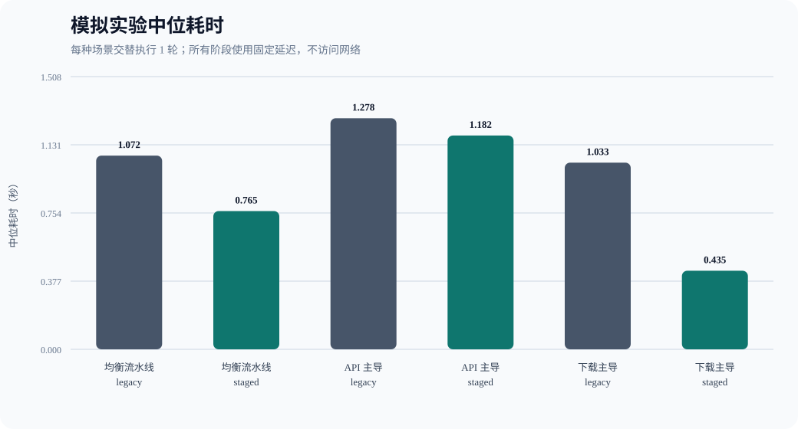
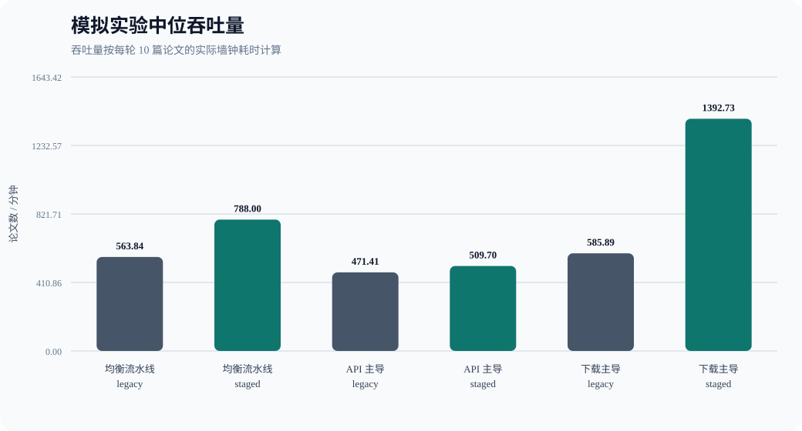
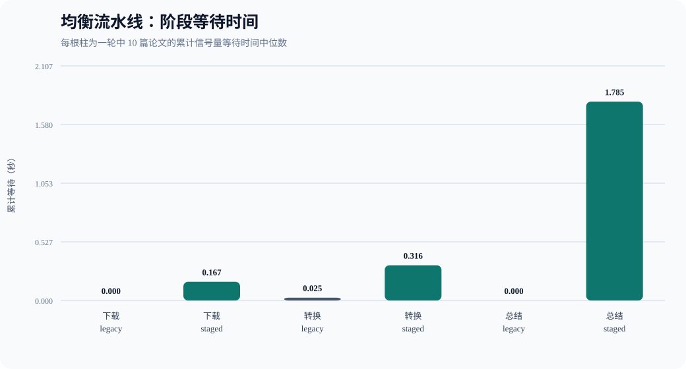
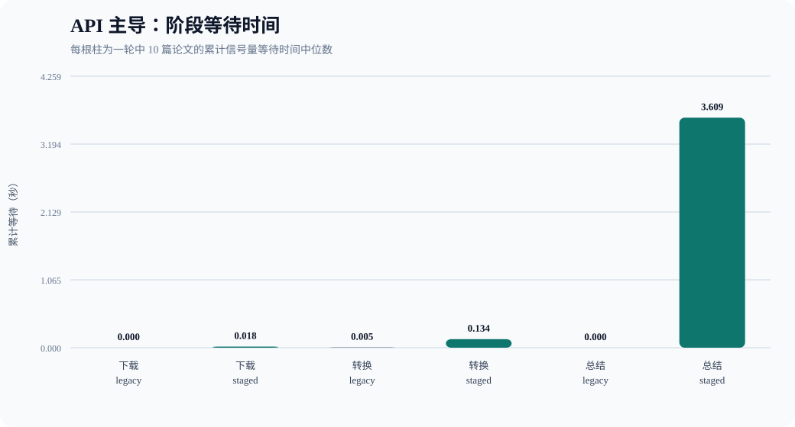
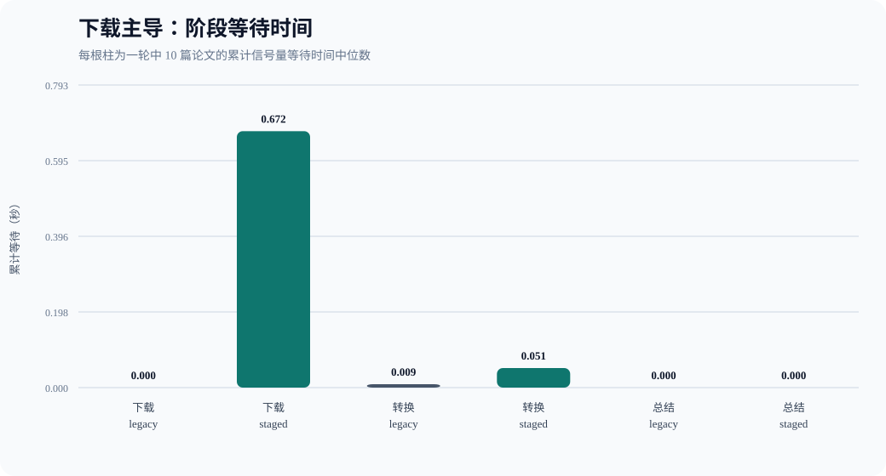

# 论文流水线分阶段并发：可控模拟实验报告

> 本实验完全离线：不下载真实 PDF、不调用模型 API。它验证调度算法本身，不能替代真实网络环境测试。

- 生成时间：2026-10-23T11:12:09.082327+00:00
- 论文清单：`D:\BUAA\homework\26-27-Autumn\ai\BUAA_Paper_Research_Agent\benchmark_manifest_10.json`（10 篇，与真实 Benchmark 相同）
- 每个场景轮数：1 轮 legacy + 1 轮 staged
- 执行顺序：奇数轮 legacy→staged，偶数轮 staged→legacy
- 计时：`time.perf_counter()` 单调时钟
- 随机性：无随机延迟；每篇论文使用固定、可复现的耗时倍率

## 模拟配置

| 场景 | 下载/篇 | 转换/篇 | 总结/篇 | 目的 |
|---|---:|---:|---:|---|
| 均衡流水线 | 0.040s | 0.015s | 0.120s | 三个阶段均有可观耗时，检验流水线重叠收益 |
| API 主导 | 0.010s | 0.005s | 0.200s | 总结远慢于其他阶段，模拟当前真实系统瓶颈 |
| 下载主导 | 0.120s | 0.010s | 0.030s | 下载占主导，检验下载并发 4 的收益 |

流水线并发参数：

| 参数 | 值 |
|---|---:|
| legacy_concurrency | 2 |
| download_concurrency | 4 |
| convert_concurrency | 1 |
| summary_concurrency | 2 |
| max_in_flight | 8 |

## 总体结果

| 场景 | Legacy 中位数 | Staged 中位数 | 改善率 | Legacy 范围 | Staged 范围 | 最终失败 |
|---|---:|---:|---:|---:|---:|---:|
| 均衡流水线 | 1.072s | 0.765s | 28.63% | 1.072–1.072s | 0.765–0.765s | 0 |
| API 主导 | 1.278s | 1.182s | 7.50% | 1.278–1.278s | 1.182–1.182s | 0 |
| 下载主导 | 1.033s | 0.435s | 57.89% | 1.033–1.033s | 0.435–0.435s | 0 |

改善率 = `(Legacy 中位耗时 - Staged 中位耗时) / Legacy 中位耗时 × 100%`。

## 实际并发上限

以下是全部轮次中观测到的最大同时执行数量：

| 场景 | 模式 | 下载 | 转换 | 总结 | 整篇调度等待中位数 |
|---|---|---:|---:|---:|---:|
| 均衡流水线 | legacy | 2 | 1 | 2 | 3.611s |
| 均衡流水线 | staged | 4 | 1 | 2 | 0.000s |
| API 主导 | legacy | 2 | 1 | 2 | 4.295s |
| API 主导 | staged | 4 | 1 | 2 | 0.000s |
| 下载主导 | legacy | 2 | 1 | 2 | 3.284s |
| 下载主导 | staged | 4 | 1 | 2 | 0.000s |

## 各场景阶段等待

### 均衡流水线

### API 主导

### 下载主导

## 各轮结果

| 场景 | 轮次 | Legacy(s) | Staged(s) | 本轮改善率 |
|---|---:|---:|---:|---:|
| 均衡流水线 | 1 | 1.072 | 0.765 | 28.63% |
| API 主导 | 1 | 1.278 | 1.182 | 7.50% |
| 下载主导 | 1 | 1.033 | 0.435 | 57.89% |

## 结论

- **均衡流水线**：staged 中位耗时缩短 28.63%。
- **API 主导**：staged 中位耗时缩短 7.50%。
- **下载主导**：staged 中位耗时缩短 57.89%。

模拟实验用于隔离调度算法的影响：若 staged 在均衡或下载主导场景中加速，说明分阶段信号量能够减少整篇论文占槽造成的队头阻塞；若 API 主导场景收益很小，则说明总结并发度相同会限制最终收益。

## 实验限制

- `asyncio.sleep` 和 `time.sleep` 只能模拟耗时，不能复现真实网络协议、服务端限流和 PDF 解析负载。
- Windows 线程调度和计时精度会产生少量波动，因此以 20 轮中位数而不是单轮结果判断。
- 模拟实验只能证明调度机制在给定工作负载下的效果，真实端到端结论仍应以真实 Benchmark 为准。
- 三种场景均在同一进程中顺序运行，不同时执行两种模式。
