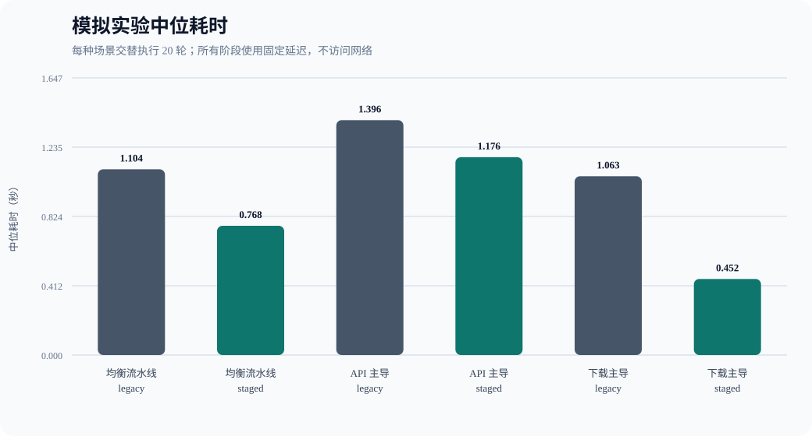
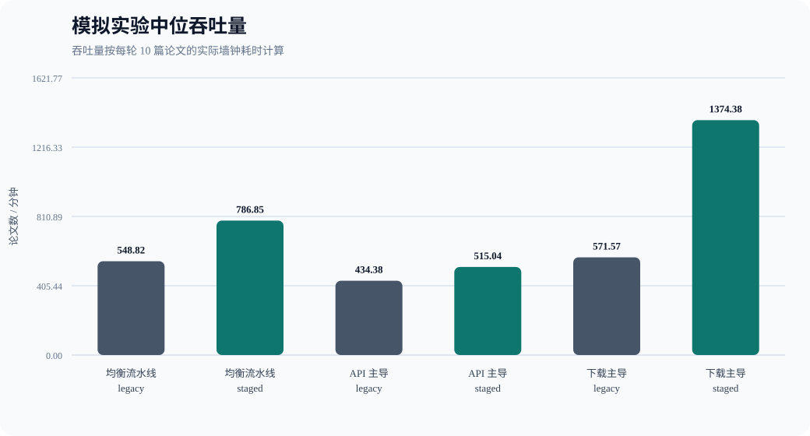
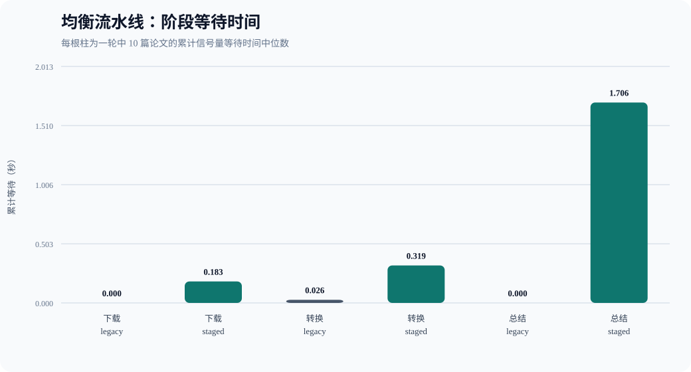
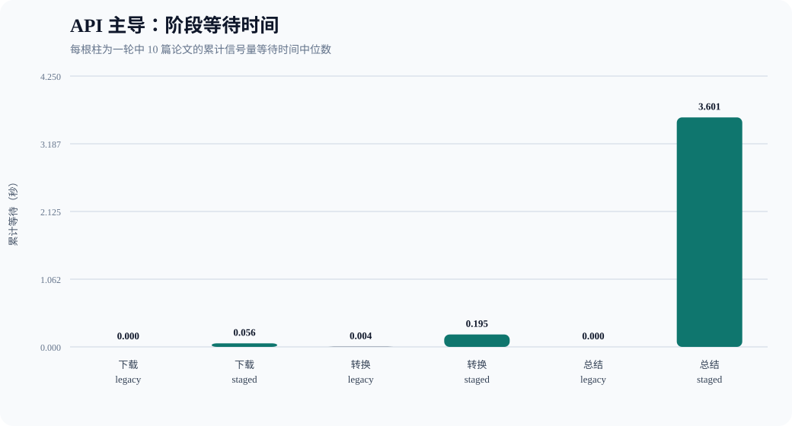
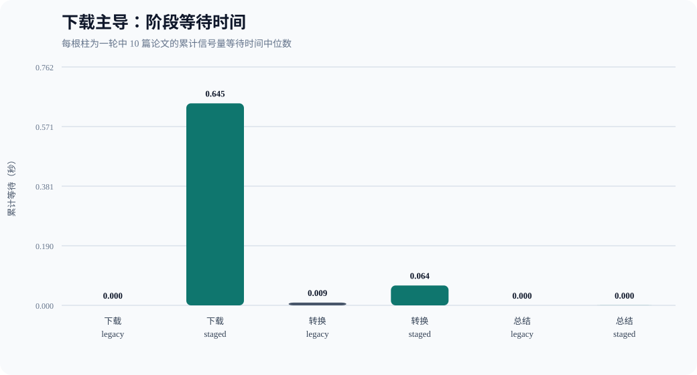

# 论文流水线分阶段并发：可控模拟实验报告

==md文件位置：BUAA_Paper_Research_Agent\outputs\benchmarks\simulated\simulation-20261023-191217-953900==

> 本实验完全离线：不下载真实 PDF、不调用模型 API。它验证调度算法本身，不能替代真实网络环境测试。

- 生成时间：2026-10-23T11:14:16.940165+00:00
- 论文清单：`D:\BUAA\homework\26-27-Autumn\ai\BUAA_Paper_Research_Agent\benchmark_manifest_10.json`（10 篇，与真实 Benchmark 相同）
- 每个场景轮数：20 轮 legacy + 20 轮 staged
- 执行顺序：奇数轮 legacy→staged，偶数轮 staged→legacy
- 计时：`time.perf_counter()` 单调时钟
- 随机性：无随机延迟；每篇论文使用固定、可复现的耗时倍率

## 模拟配置

| 场景 | 下载/篇 | 转换/篇 | 总结/篇 | 目的 |
|---|---:|---:|---:|---|
| 均衡流水线 | 0.040s | 0.015s | 0.120s | 三个阶段均有可观耗时，检验流水线重叠收益 |
| API 主导 | 0.010s | 0.005s | 0.200s | 总结远慢于其他阶段，模拟当前真实系统瓶颈 |
| 下载主导 | 0.120s | 0.010s | 0.030s | 下载占主导，检验下载并发 4 的收益 |

## 三种实验设置说明

三个场景使用完全相同的 10 篇论文、论文顺序、并发参数和调度代码，仅改变下载、转换、总结三个阶段的固定模拟耗时。每篇论文还使用 0.80～1.25 的固定耗时倍率，用来模拟论文大小和处理难度差异；同一篇论文在 legacy 与 staged 中的倍率完全相同，因此不会偏向任何模式。

### 1. 均衡流水线

- 基础耗时：下载 40ms、转换 15ms、总结 120ms。
- 单篇三个阶段的基础总耗时为 175ms，其中下载约占 22.9%、转换约占 8.6%、总结约占 68.6%。
- 这里的“均衡”不是指三个阶段耗时完全相等，而是指下载和转换的占比仍然足以影响总耗时，三个阶段之间存在可利用的流水线重叠空间。
- 它模拟一般论文处理任务：API 总结最慢，但 PDF 获取和解析同样不是可以忽略的瞬时操作。
- 预期现象：staged 可以在前两篇论文总结时继续下载和转换后续论文，从而减少 legacy 整篇占槽造成的队头阻塞。

### 2. API 主导

- 基础耗时：下载 10ms、转换 5ms、总结 200ms。
- 单篇基础总耗时为 215ms，其中总结约占 93.0%，下载和转换合计仅占约 7.0%。
- 它模拟真实系统中模型响应远慢于 PDF 下载和文本转换的情况，也是当前真实 Benchmark 最接近的抽象场景。
- 两种模式的有效总结并发都为 2，因此 staged 无法提高最主要瓶颈的并发上限，只能让很短的下载和转换提前完成。
- 预期现象：staged 仍可能因减少整篇调度等待而略有收益，但改善率应明显低于下载主导场景；如果外部 API 波动很大，这部分收益可能被噪声覆盖。

### 3. 下载主导

- 基础耗时：下载 120ms、转换 10ms、总结 30ms。
- 单篇基础总耗时为 160ms，其中下载占 75.0%，转换占 6.25%，总结占 18.75%。
- 它模拟 PDF 较大、论文站点响应较慢，但下载服务允许并行请求的情况。这里故意不模拟 arXiv 的强制串行限速，用于单独测量下载并发从 2 提升到 4 的调度上限。
- legacy 最多只有两篇论文进入完整流程，因此同时下载数量不会超过 2；staged 可以使用 4 个下载槽，并让已下载论文继续进入转换和总结阶段。
- 预期现象：这是最有利于 staged 的场景，用来验证下载并发和阶段重叠能够带来的理论收益，而不是代表当前 5 篇 arXiv 测试集的真实下载表现。

### 三种设置的核心区别

| 对比项 | 均衡流水线 | API 主导 | 下载主导 |
|---|---|---|---|
| 主要耗时来源 | 总结为主，下载/转换仍不可忽略 | 总结占绝对主导 | 下载占主导 |
| staged 可利用的能力 | 三阶段重叠 | 主要是减少队头阻塞 | 下载并发 4 + 阶段重叠 |
| 预期收益 | 中等 | 较小 | 最大 |
| 对真实系统的含义 | 展示一般流水线收益 | 最接近当前 API 瓶颈 | 展示下载可并行时的上限 |

因此，这三个场景不是三套不同算法，而是对同一套调度算法进行敏感性分析：通过改变瓶颈所在阶段，观察 staged 在什么条件下有效、收益何时受限。

流水线并发参数：

| 参数 | 值 |
|---|---:|
| legacy_concurrency | 2 |
| download_concurrency | 4 |
| convert_concurrency | 1 |
| summary_concurrency | 2 |
| max_in_flight | 8 |

## 总体结果

| 场景 | Legacy 中位数 | Staged 中位数 | 改善率 | Legacy 范围 | Staged 范围 | 最终失败 |
|---|---:|---:|---:|---:|---:|---:|
| 均衡流水线 | 1.104s | 0.768s | 30.44% | 1.056–1.195s | 0.711–0.832s | 0 |
| API 主导 | 1.396s | 1.176s | 15.78% | 1.338–1.439s | 1.096–1.253s | 0 |
| 下载主导 | 1.063s | 0.452s | 57.46% | 0.984–1.187s | 0.408–0.592s | 0 |

改善率 = `(Legacy 中位耗时 - Staged 中位耗时) / Legacy 中位耗时 × 100%`。

## 实际并发上限

以下是全部轮次中观测到的最大同时执行数量：

| 场景 | 模式 | 下载 | 转换 | 总结 | 整篇调度等待中位数 |
|---|---|---:|---:|---:|---:|
| 均衡流水线 | legacy | 2 | 1 | 2 | 3.657s |
| 均衡流水线 | staged | 4 | 1 | 2 | 0.000s |
| API 主导 | legacy | 2 | 1 | 2 | 4.506s |
| API 主导 | staged | 4 | 1 | 2 | 0.000s |
| 下载主导 | legacy | 2 | 1 | 2 | 3.501s |
| 下载主导 | staged | 4 | 1 | 2 | 0.000s |

## 各场景阶段等待

### 均衡流水线

### API 主导

### 下载主导

## 各轮结果

| 场景 | 轮次 | Legacy(s) | Staged(s) | 本轮改善率 |
|---|---:|---:|---:|---:|
| 均衡流水线 | 1 | 1.101 | 0.738 | 32.99% |
| 均衡流水线 | 2 | 1.093 | 0.747 | 31.62% |
| 均衡流水线 | 3 | 1.078 | 0.768 | 28.75% |
| 均衡流水线 | 4 | 1.068 | 0.781 | 26.88% |
| 均衡流水线 | 5 | 1.122 | 0.780 | 30.43% |
| 均衡流水线 | 6 | 1.121 | 0.747 | 33.33% |
| 均衡流水线 | 7 | 1.073 | 0.768 | 28.49% |
| 均衡流水线 | 8 | 1.122 | 0.760 | 32.21% |
| 均衡流水线 | 9 | 1.076 | 0.749 | 30.40% |
| 均衡流水线 | 10 | 1.074 | 0.782 | 27.25% |
| 均衡流水线 | 11 | 1.058 | 0.711 | 32.80% |
| 均衡流水线 | 12 | 1.061 | 0.763 | 28.07% |
| 均衡流水线 | 13 | 1.056 | 0.768 | 27.27% |
| 均衡流水线 | 14 | 1.111 | 0.764 | 31.25% |
| 均衡流水线 | 15 | 1.107 | 0.818 | 26.09% |
| 均衡流水线 | 16 | 1.168 | 0.796 | 31.85% |
| 均衡流水线 | 17 | 1.195 | 0.832 | 30.43% |
| 均衡流水线 | 18 | 1.130 | 0.820 | 27.38% |
| 均衡流水线 | 19 | 1.168 | 0.785 | 32.82% |
| 均衡流水线 | 20 | 1.195 | 0.809 | 32.29% |
| API 主导 | 1 | 1.354 | 1.169 | 13.67% |
| API 主导 | 2 | 1.375 | 1.233 | 10.35% |
| API 主导 | 3 | 1.360 | 1.170 | 14.00% |
| API 主导 | 4 | 1.424 | 1.242 | 12.79% |
| API 主导 | 5 | 1.439 | 1.170 | 18.67% |
| API 主导 | 6 | 1.406 | 1.098 | 21.91% |
| API 主导 | 7 | 1.403 | 1.188 | 15.28% |
| API 主导 | 8 | 1.343 | 1.096 | 18.34% |
| API 主导 | 9 | 1.409 | 1.132 | 19.67% |
| API 主导 | 10 | 1.408 | 1.253 | 11.05% |
| API 主导 | 11 | 1.394 | 1.191 | 14.61% |
| API 主导 | 12 | 1.356 | 1.235 | 8.93% |
| API 主导 | 13 | 1.355 | 1.160 | 14.36% |
| API 主导 | 14 | 1.380 | 1.194 | 13.43% |
| API 主导 | 15 | 1.410 | 1.120 | 20.58% |
| API 主导 | 16 | 1.398 | 1.192 | 14.70% |
| API 主导 | 17 | 1.401 | 1.205 | 13.96% |
| API 主导 | 18 | 1.362 | 1.172 | 13.94% |
| API 主导 | 19 | 1.419 | 1.152 | 18.81% |
| API 主导 | 20 | 1.338 | 1.179 | 11.88% |
| 下载主导 | 1 | 1.009 | 0.422 | 58.16% |
| 下载主导 | 2 | 1.068 | 0.458 | 57.14% |
| 下载主导 | 3 | 1.038 | 0.450 | 56.67% |
| 下载主导 | 4 | 1.032 | 0.469 | 54.58% |
| 下载主导 | 5 | 1.062 | 0.408 | 61.57% |
| 下载主导 | 6 | 1.071 | 0.443 | 58.66% |
| 下载主导 | 7 | 1.064 | 0.455 | 57.20% |
| 下载主导 | 8 | 1.057 | 0.454 | 57.02% |
| 下载主导 | 9 | 1.095 | 0.471 | 56.96% |
| 下载主导 | 10 | 1.187 | 0.592 | 50.11% |
| 下载主导 | 11 | 1.114 | 0.434 | 61.06% |
| 下载主导 | 12 | 1.058 | 0.425 | 59.82% |
| 下载主导 | 13 | 1.077 | 0.458 | 57.48% |
| 下载主导 | 14 | 1.090 | 0.433 | 60.29% |
| 下载主导 | 15 | 1.051 | 0.464 | 55.86% |
| 下载主导 | 16 | 1.047 | 0.450 | 57.01% |
| 下载主导 | 17 | 1.081 | 0.424 | 60.78% |
| 下载主导 | 18 | 1.086 | 0.467 | 57.03% |
| 下载主导 | 19 | 0.984 | 0.425 | 56.85% |
| 下载主导 | 20 | 1.055 | 0.460 | 56.37% |

## 结论

- **均衡流水线**：staged 中位耗时缩短 30.44%。
- **API 主导**：staged 中位耗时缩短 15.78%。
- **下载主导**：staged 中位耗时缩短 57.46%。

模拟实验用于隔离调度算法的影响：若 staged 在均衡或下载主导场景中加速，说明分阶段信号量能够减少整篇论文占槽造成的队头阻塞；若 API 主导场景收益很小，则说明总结并发度相同会限制最终收益。

## 实验限制

- `asyncio.sleep` 和 `time.sleep` 只能模拟耗时，不能复现真实网络协议、服务端限流和 PDF 解析负载。
- Windows 线程调度和计时精度会产生少量波动，因此以 20 轮中位数而不是单轮结果判断。
- 模拟实验只能证明调度机制在给定工作负载下的效果，真实端到端结论仍应以真实 Benchmark 为准。
- 三种场景均在同一进程中顺序运行，不同时执行两种模式。
